# Arsitektur

Dokumen ini menjelaskan topologi sistem, alur data, model data (ERD), deployment, dan keputusan teknis utama. Diagram memakai [Mermaid](https://mermaid.js.org/) sehingga tampil langsung di GitHub, VS Code (dengan ekstensi Mermaid), dan sebagian besar penampil Markdown.

Dokumen terkait: [FEATURES.md](FEATURES.md), [API.md](API.md), [TESTING.md](TESTING.md).

## Daftar isi

1. [Gambaran umum](#1-gambaran-umum)
2. [Topologi sistem](#2-topologi-sistem)
3. [Lapisan aplikasi](#3-lapisan-aplikasi)
4. [Autentikasi dan otorisasi](#4-autentikasi-dan-otorisasi)
5. [Model data dan ERD](#5-model-data-dan-erd)
6. [Alur status](#6-alur-status)
7. [Alur data penting](#7-alur-data-penting)
8. [Performa dan caching](#8-performa-dan-caching)
9. [Deployment](#9-deployment)
10. [Migrasi database](#10-migrasi-database)
11. [Keamanan](#11-keamanan)
12. [Batasan dan hal yang perlu diketahui](#12-batasan-dan-hal-yang-perlu-diketahui)

---

## 1. Gambaran umum

Satu aplikasi **Next.js 16 (App Router)** yang menjalankan tiga hal sekaligus dalam satu deployment:

| Bagian | Lokasi | Fungsi |
| --- | --- | --- |
| Website | `app/(site)/` | Halaman publik, portal siswa, portal guru (React 19, client-side fetch ke `/api`) |
| Admin CMS | `app/(payload)/admin/` | Panel Payload CMS 3.90 untuk admin sekolah |
| API | `app/(payload)/api/` | REST Payload (catch-all) dan endpoint khusus website |

Data disimpan di **PostgreSQL (Supabase)** melalui adapter Payload (Drizzle + `node-postgres`). Berkas upload disimpan di **Vercel Blob**. Tidak ada layanan terpisah (tanpa message queue, Redis, atau WebSocket); pembaruan "real-time" memakai polling.

| Lapisan | Teknologi |
| --- | --- |
| Framework | Next.js 16, React 19, TypeScript |
| CMS dan ORM | Payload CMS 3.90, adapter `@payloadcms/db-postgres` (Drizzle) |
| Database | PostgreSQL di Supabase (lewat Supavisor pooler) |
| Penyimpanan berkas | Vercel Blob (`@payloadcms/storage-vercel-blob`), pemrosesan gambar dengan Sharp |
| Editor teks | Lexical (admin dan editor detail karya) |
| Hosting | Vercel (Serverless Functions, region `hnd1`) |
| Test | Vitest (database sungguhan, transaksi di-rollback) |

---

## 2. Topologi sistem

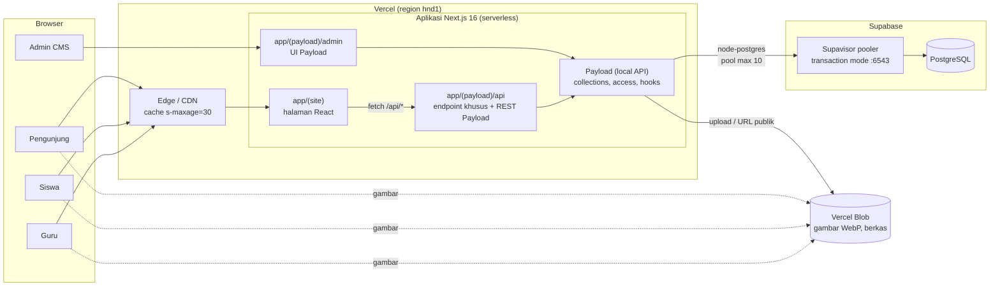

Poin penting:

- Semua akses data lewat Payload, baik dari admin maupun dari endpoint `/api`. Endpoint khusus memanggil Payload **local API** (`getPayload`) langsung di server, bukan lewat HTTP.
- Hitungan besar (suka, komentar, suara, belum dibaca) memakai SQL agregat langsung lewat `payload.db.drizzle` (`lib/dbCounts.ts`) untuk menghindari N+1 query.
- Browser memuat gambar langsung dari Vercel Blob, tidak lewat aplikasi.

### Komunikasi real-time (polling)

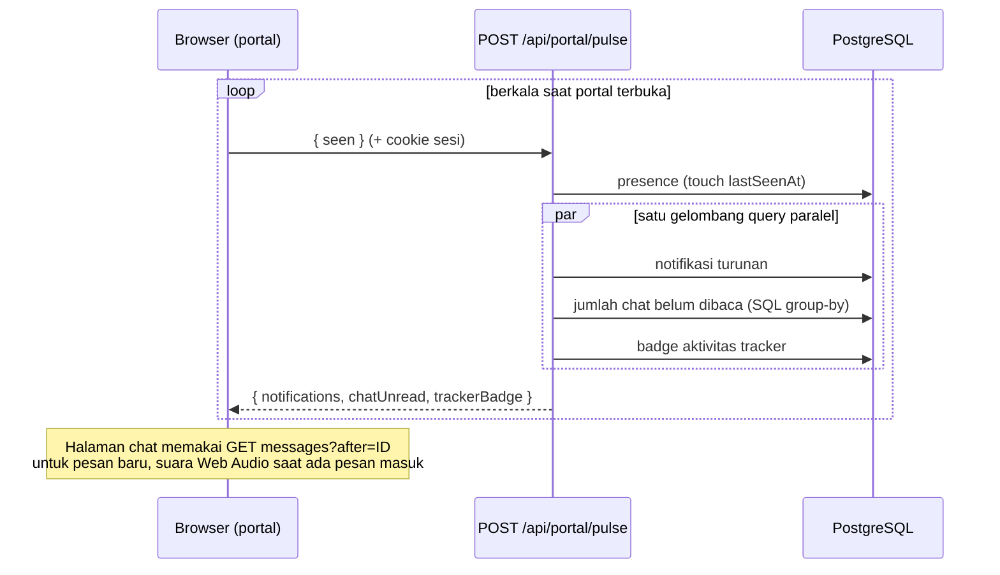

---

## 3. Lapisan aplikasi

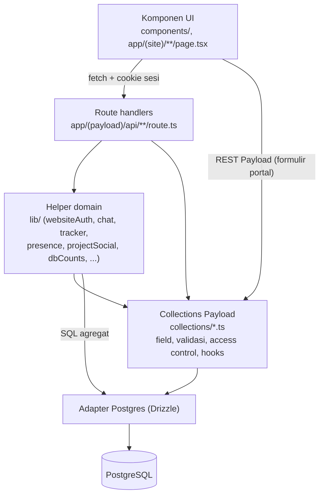

Pembagian tanggung jawab:

| Lapisan | Tanggung jawab | Contoh |
| --- | --- | --- |
| Collection | Skema, validasi, aturan akses, hook (mis. batasi field yang boleh diubah siswa, hitung slug) | `collections/Portfolio.ts` |
| `lib/` | Logika lintas endpoint: sesi website, akses chat/tracker, presence, hitungan | `lib/tracker.ts` `projectAccess` |
| Route handler | Alur khusus yang tidak cocok untuk REST generik: feed, leaderboard, chat, tracker, tindakan proyek | `community/projects/[id]/actions` |
| UI | Render, state klien, polling | `components/chat/*`, `components/tracker/*` |

Pola akses data: **collection yang sensitif dikunci hanya untuk admin**, dan klien hanya bisa lewat route khusus yang menegakkan keanggotaan (chat, tracker, suka/komentar proyek). Collection yang aman dipakai langsung lewat REST (karya, proyek, peluang, profil) memakai access control per peran.

### Struktur direktori

```text
app/
  (site)/            halaman publik dan portal (siswa/guru), CSS per area
  (payload)/admin/   UI admin Payload
  (payload)/api/     endpoint (lihat API.md)
collections/         definisi collection Payload
components/          komponen UI (chat/, tracker/, payload/ untuk admin)
lib/                 helper server dan klien
migrations/          migrasi SQL manual + index.ts
scripts/             seed data
tests/               Vitest + harness
docs/                dokumentasi
```

---

## 4. Autentikasi dan otorisasi

Ada **dua sistem login terpisah**:

| | Website (siswa/guru) | Admin CMS |
| --- | --- | --- |
| Collection | `users` | `admins` |
| Halaman login | `/login` | `/admin/login` |
| Cookie | `karyakita-session` (httpOnly) | `payload-token` |
| Pemeriksaan | `authenticateWebsiteRequest` (`lib/websiteAuth.ts`) | Autentikasi Payload bawaan |

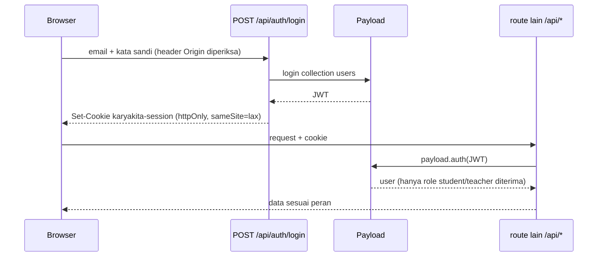

Catch-all `/api/[...slug]` menerjemahkan cookie `karyakita-session` menjadi header otorisasi Payload sehingga formulir portal dapat memakai REST Payload dengan aturan akses collection.

### Matriks peran (ringkas)

| Sumber daya | Pengunjung | Siswa | Guru | Admin |
| --- | --- | --- | --- | --- |
| Karya/proyek terbit | baca | baca | baca | semua |
| Karya sendiri (draf) | - | CRUD, tidak bisa menerbitkan | - | semua |
| Verifikasi karya | - | - | dalam cakupan kelas/program | semua |
| Proyek | baca (terbit) | CRUD sebagai pengelola | tinjau bila diundang | semua |
| Suka/komentar | - | ya (tidak karya sendiri) | ya | moderasi |
| Voting award | - | ya (1 suara/award) | - | atur award |
| Peluang | baca (terbuka) | minat | CRUD | semua |
| Chat, tracker | - | anggota | anggota/mentor | via CMS |

Aturan rinci ada di `access` tiap file `collections/*.ts` dan di route handler.

---

## 5. Model data dan ERD

Semua tabel dikelola Payload (nama tabel snake_case dari slug). Field `array` dan `hasMany` menghasilkan tabel anak (`projects_members`, `users_interests`, dst.). Beberapa data ringan disimpan sebagai kolom `jsonb` (`project_tasks.assignees/labels/checklist`, `users.pinned_works`, `project_activity.meta`) agar tidak perlu tabel relasi tambahan.

### 5.1 Akademik, pengguna, dan karya

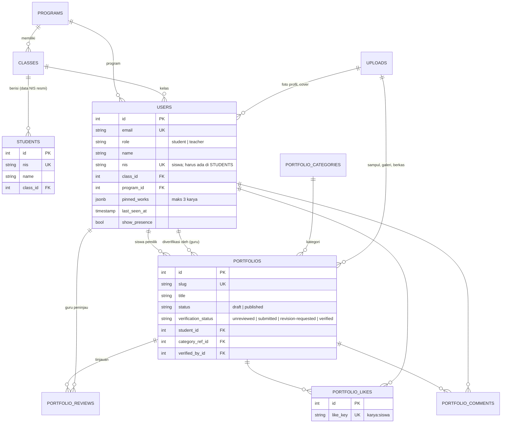

`USERS` menyimpan akun siswa dan guru dalam satu tabel (dibedakan `role`). `STUDENTS` adalah daftar resmi sekolah, terpisah dari akun; registrasi siswa memeriksa NIS di sini.

### 5.2 Proyek kolaborasi, penghargaan, dan peluang

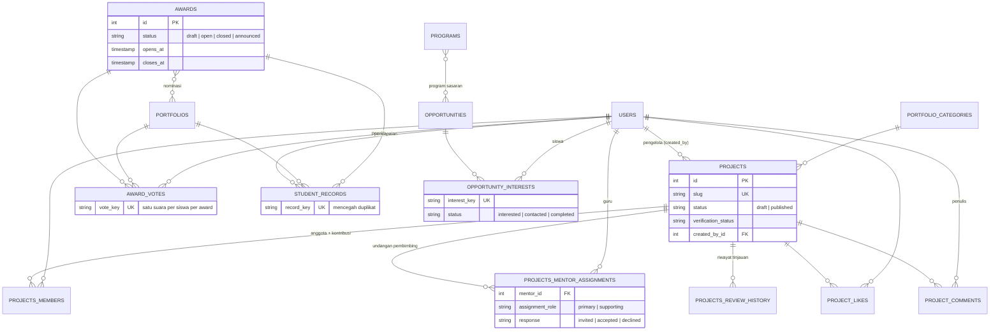

### 5.3 Pesan (chat)

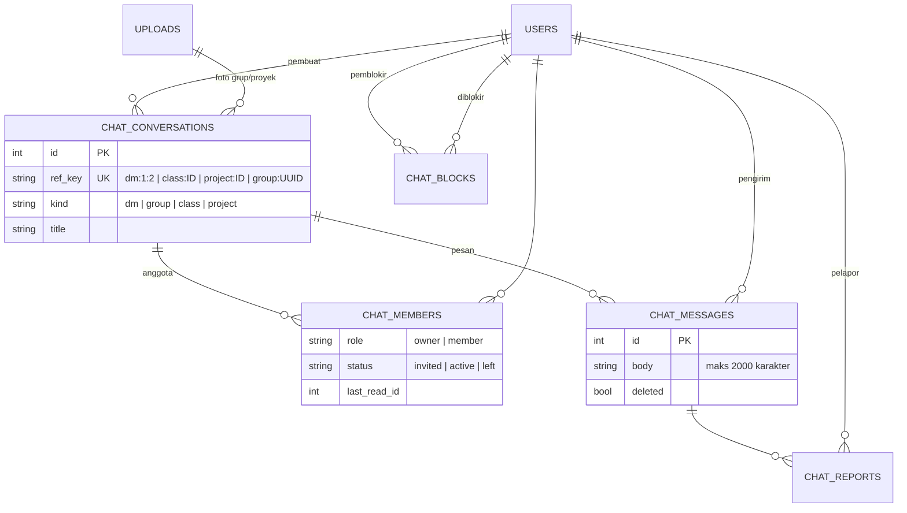

Ruang `class:ID` dan `project:ID` dibuat lazily (`ensureRoom`); keanggotaannya diturunkan dari kelas pengguna atau tim proyek, bukan disimpan manual.

### 5.4 Tracker proyek

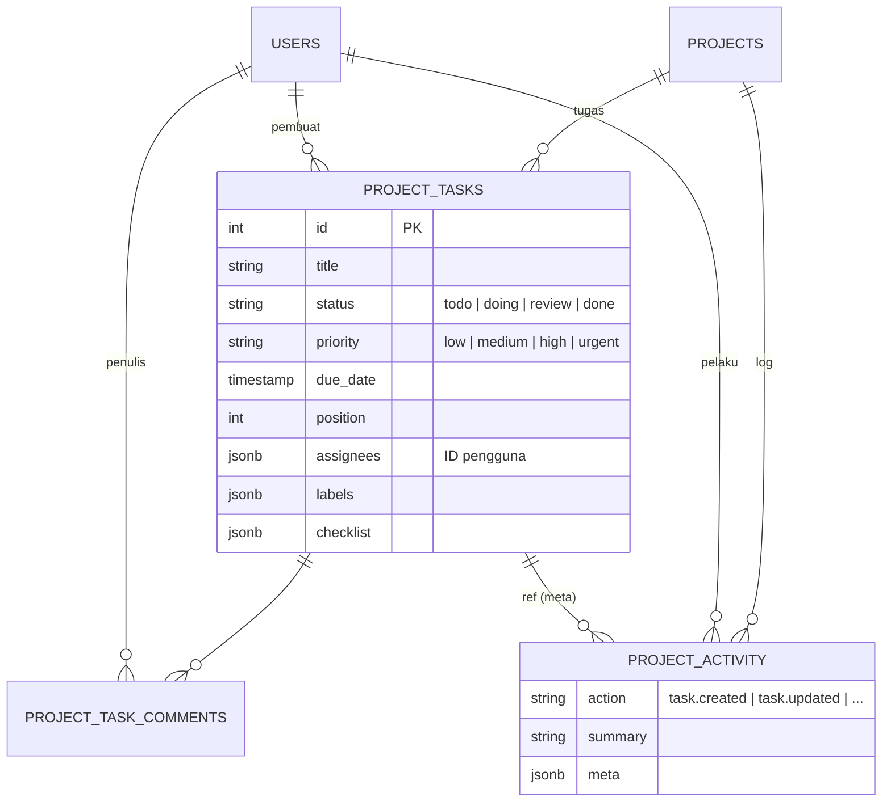

### 5.5 Konten beranda dan media

| Tabel | Isi | Relasi |
| --- | --- | --- |
| `home_banners` | Slide hero (`status`, `sort_order`) | `image_id` -> `uploads` |
| `testimonials` | Testimoni beranda | tanpa relasi |
| `uploads` | Metadata berkas (WebP, ukuran, titik fokus, `alt`) | direferensikan banyak tabel |
| `admins` | Akun CMS | terpisah dari `users` |

---

## 6. Alur status

### Karya

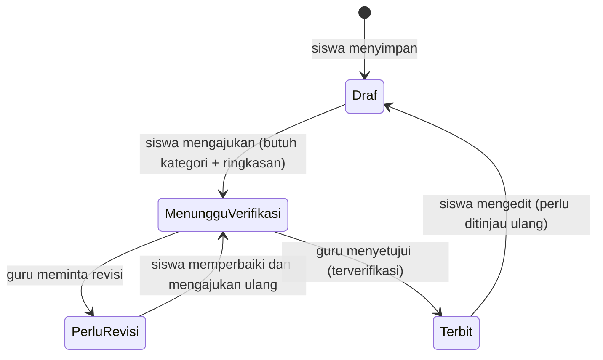

Draf yang belum diajukan bersifat pribadi: guru tidak melihatnya dan tidak bisa meninjau (409).

### Proyek (pembimbing dan verifikasi)

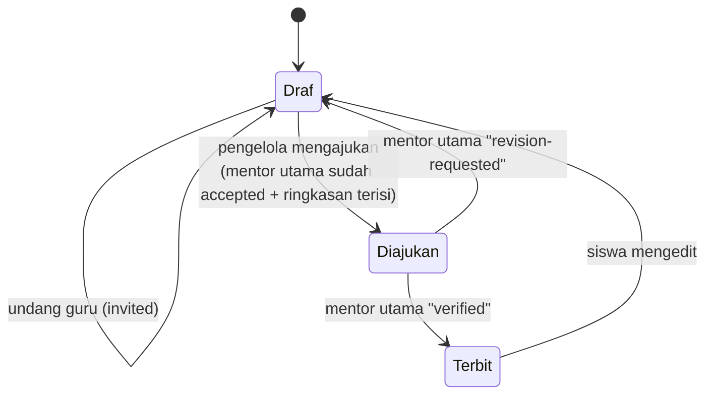

Mentor pendamping hanya dapat memberi komentar. Respons undangan (`accepted`/`declined`) hanya sekali.

### Award

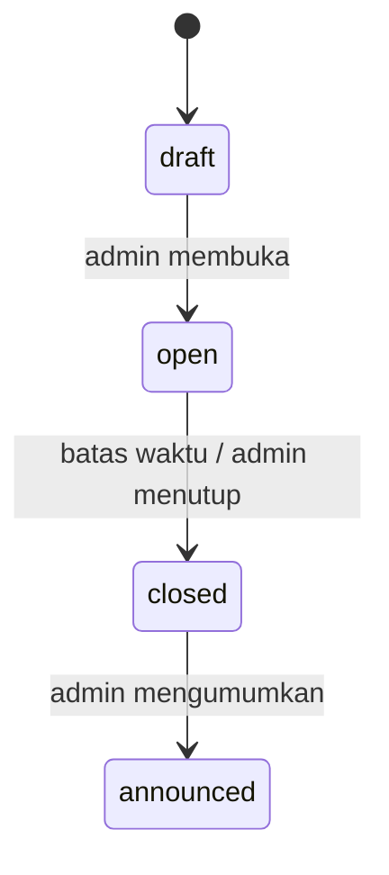

Hasil suara (`/api/awards/[id]/results`) hanya terbuka setelah `announced`.

---

## 7. Alur data penting

### Memuat beranda

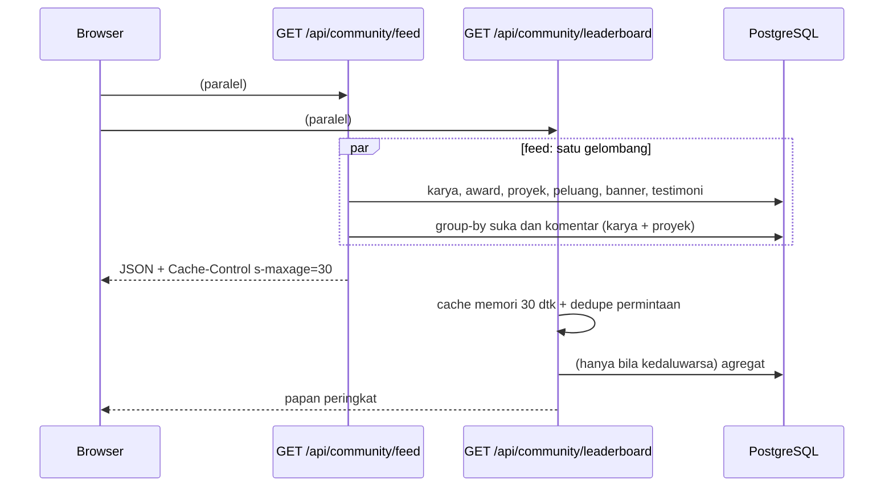

### Mengajukan dan memverifikasi karya

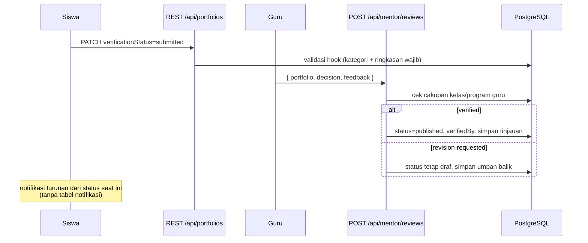

### Upload gambar

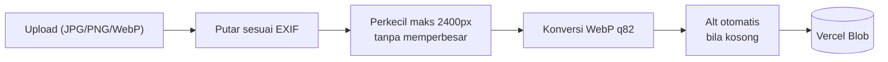

---

## 8. Performa dan caching

Biaya utama di lingkungan serverless adalah **round trip ke database**, bukan CPU. Pola yang dipakai:

| Teknik | Tempat | Efek |
| --- | --- | --- |
| Query independen dijalankan paralel (`Promise.all`) | semua route baca | satu "gelombang" round trip |
| `pagination: false` | daftar yang tidak butuh total | melewati query `count` |
| SQL group-by | `lib/dbCounts.ts` (`groupCount`, `awardVoteCounts`, `unreadByConversation`) | hitungan suka/komentar/belum dibaca dalam satu query |
| Cache memori + dedupe | `/api/community/leaderboard` | hitung ulang paling cepat tiap 30 dtk, permintaan bersamaan berbagi satu perhitungan |
| `Cache-Control: public, s-maxage=30, stale-while-revalidate=300` | endpoint publik | CDN menyajikan cache |
| Polling gabungan | `/api/portal/pulse` | satu request menggantikan tiga polling |
| Pooler transaction mode | `DATABASE_URL` port 6543 | banyak fungsi serverless berbagi koneksi |

Catatan: cache memori bersifat per instance serverless, jadi hanya mengurangi beban, bukan jaminan konsistensi global.

---

## 9. Deployment

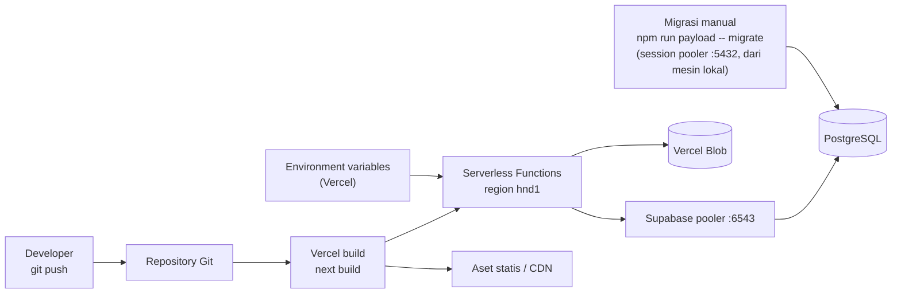

### Environment variables

| Variabel | Kegunaan |
| --- | --- |
| `DATABASE_URL` | Koneksi PostgreSQL. **Vercel: Transaction Pooler port 6543.** Lokal / menjalankan migrasi: Session Pooler port 5432 |
| `DATABASE_POOL_MAX` | Batas koneksi per fungsi (Vercel: 10; bawaan 5) |
| `PAYLOAD_SECRET` | Secret token dan keamanan Payload |
| `NEXT_PUBLIC_SERVER_URL` | URL dasar aplikasi |
| `BLOB_READ_WRITE_TOKEN` | Token Vercel Blob (mengaktifkan penyimpanan Blob) |
| `CMS_ADMIN_EMAIL` / `CMS_ADMIN_PASSWORD` / `CMS_ADMIN_NAME` | Hanya untuk `seed:cms-admin` |

Nilai secret tidak boleh masuk Git; `.env.example` hanya berisi templat.

### Lingkungan

| | Lokal | Produksi (Vercel) |
| --- | --- | --- |
| Perintah | `npm run dev` | build `next build` |
| Database | pooler :5432 (session) | pooler :6543 (transaction) |
| Upload | Blob bila token diisi, jika tidak URL `/media` | Vercel Blob |
| Region fungsi | lokal | `hnd1` (`vercel.json`) |

Region fungsi sebaiknya dekat dengan region project Supabase; jarak antar keduanya langsung menambah latensi setiap query.

### Urutan rilis yang aman

1. Terapkan migrasi baru ke database (`migrate:status` lalu `migrate`) **sebelum** kode yang memakainya dideploy. Migrasi bersifat aditif (tabel/kolom baru) sehingga kode lama tetap berjalan.
2. Pastikan environment variables Vercel sudah benar.
3. Push ke branch yang terhubung; Vercel membangun dan mendeploy.
4. Verifikasi beranda, `/admin/login`, feed, leaderboard, dan upload.

---

## 10. Migrasi database

- **Schema push dimatikan** (`push: false` di `payload.config.ts`). Alasannya: skema lokal tanpa plugin Blob tidak memuat kolom internal `_objectkey`, sehingga push otomatis bisa menghapusnya dari database bersama.
- Setiap perubahan collection **harus** disertai file migrasi di `migrations/` dan entri di `migrations/index.ts` (urutan menurut nama berkas).
- Collection baru juga menambah kolom `<slug>_id` (dengan FK dan indeks) pada `payload_locked_documents_rels`; jika terlupa, halaman admin collection itu error "column ... does not exist".
- Migrasi yang ada **bukan baseline lengkap** untuk database kosong; database baru memerlukan inisialisasi skema awal yang direncanakan.
- Jalankan migrasi lewat Session Pooler (port 5432). Perintah `migrate` di mode dev dapat menampilkan prompt konfirmasi "data loss" dari push dev; jangan dijawab otomatis, periksa penyebabnya lebih dulu.

Kronologi migrasi (kelompok): Blob key, review portofolio, detail dan galeri portofolio, proyek dan mentor, home banner, kategori, draf, testimoni, tampilan profil, karya semat, chat, tracker, sosial proyek.

---

## 11. Keamanan

| Aspek | Penerapan |
| --- | --- |
| Pemisahan login | `users` (website) dan `admins` (CMS) terpisah; siswa/guru tidak bisa masuk CMS |
| Sesi | JWT di cookie httpOnly, `sameSite=lax`, `secure` di produksi |
| CSRF | login/register memeriksa header `Origin` sama dengan origin server |
| Otorisasi | access control per collection + pemeriksaan keanggotaan di route khusus |
| Pembatasan field | hook mencegah siswa mengubah role, NIS, kelas/program, status verifikasi/penerbitan, dan identitas penulis/pemilik |
| Data privat | draf karya/proyek, umpan balik, riwayat tinjauan hanya untuk pemilik dan guru yang berwenang |
| Pembatasan laju | chat 25 pesan/menit, komentar proyek 8/menit, catch-all REST |
| Privasi presence | pengguna dapat menyembunyikan status online |
| Moderasi chat | blokir pengguna dan laporan pesan |
| Rahasia | disimpan di environment variables, bukan di kode |
| Integritas | kunci unik (`like_key`, `vote_key`, `interest_key`, `record_key`, `ref_key`) mencegah duplikat meski ada permintaan bersamaan |

---

## 12. Batasan dan hal yang perlu diketahui

- **Polling, bukan WebSocket.** Pesan dan notifikasi tertunda sesuai interval polling; beban database naik seiring jumlah pengguna online.
- **Notifikasi tidak disimpan.** Daftar dibuat dari status data saat ini; status "sudah dibaca" hanya di `localStorage` per browser.
- **Cache memori per instance.** Leaderboard dapat berbeda sedikit antar instance dalam jendela 30 detik.
- **Satu database untuk semua lingkungan** bila `DATABASE_URL` yang sama dipakai. Test berjalan di database itu (dibungkus transaksi yang di-rollback); jangan arahkan ke produksi tanpa pertimbangan.
- **Hitungan SQL mentah di test.** `lib/dbCounts.ts` memakai `payload.db.drizzle` langsung; harness test mengarahkannya ke transaksi test aktif (lihat [TESTING.md](TESTING.md)). Query SQL baru di luar API Payload perlu memakai jalur yang sama agar teruji.
- **Skema awal belum dapat dibuat dari nol** hanya dengan migrasi yang ada.
- **Kapasitas koneksi.** `DATABASE_POOL_MAX` dikalikan jumlah instance serverless aktif harus tetap di bawah batas pooler Supabase.
