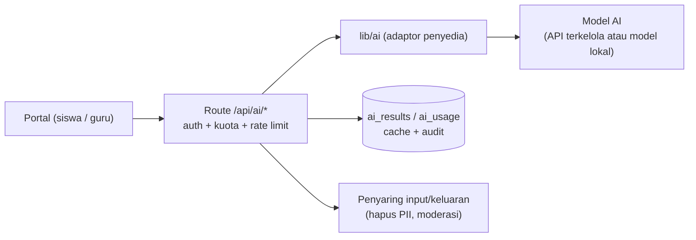

# Rekomendasi: Fitur Lanjutan dan Fitur AI

> **Status: usulan.** Belum ada yang diimplementasikan. Perkiraan waktu pengerjaan: **S** (beberapa hari), **M** (1–2 minggu), **L** (lebih dari 2 minggu). Dampak: **tinggi / sedang / rendah** terhadap nilai bagi siswa, guru, atau sekolah.

## 1. Prinsip pemilihan

1. **Bangun di atas data yang sudah ada** (karya, proyek, tinjauan, tracker, chat) sebelum menambah modul baru.
2. **Kurangi beban guru** (verifikasi, pemantauan) lebih dulu; guru yang terbantu menjaga kualitas konten.
3. **Keselamatan siswa**: sebagian besar pengguna di bawah umur. Fitur sosial dan AI harus punya moderasi, privasi, dan persetujuan yang jelas.
4. **Setiap fitur AI opsional dan dapat dimatikan**, tidak boleh menjadi satu-satunya jalan menyelesaikan tugas.

## 2. Fitur non-AI

### 2.1 Fondasi (sebaiknya lebih dulu)

| Fitur | Dampak | Usaha | Keterangan |
| --- | --- | --- | --- |
| Registrasi guru/siswa via data sekolah | tinggi | M | Lihat [REKOMENDASI-IDENTITAS.md](REKOMENDASI-IDENTITAS.md) |
| Lupa / ubah kata sandi + verifikasi email | tinggi | S | Saat ini siswa/guru harus menghubungi admin (lihat teks di halaman login) |
| Tabel notifikasi + status baca di server | tinggi | M | Lihat [REKOMENDASI-REALTIME.md](REKOMENDASI-REALTIME.md) |
| Email notifikasi/ringkasan mingguan | sedang | S | Digest karya yang menunggu verifikasi untuk guru; komentar/revisi untuk siswa |
| Moderasi konten (laporan komentar/karya, antrean admin) | tinggi | M | Chat sudah punya laporan; perluas ke komentar dan karya |
| Log audit admin | sedang | S | Siapa mengubah apa, kapan |

### 2.2 Karya dan portofolio

| Fitur | Dampak | Usaha | Keterangan |
| --- | --- | --- | --- |
| **Ekspor portofolio PDF / CV siswa** | tinggi | M | Halaman cetak berisi profil, karya semat, pencapaian, verifikasi guru; berguna untuk PKL dan melamar kerja/kuliah |
| **Tautan portofolio publik pribadi** (`/@username`) + tema | sedang | S | Sudah ada kartu bagikan dan QR; tambah slug kustom |
| Versi dan riwayat revisi karya | sedang | M | Bandingkan versi sebelum/sesudah revisi; guru melihat perubahan |
| Kolaborator pada karya (karya kelompok) | sedang | M | Saat ini kolaborasi ada di Proyek |
| Rubrik penilaian per kategori | tinggi | M | Guru menilai dengan kriteria (bukan hanya setuju/revisi); skor tampil di profil |
| Lencana keahlian (skill badges) dari karya terverifikasi | sedang | M | Mis. "UI Design – 3 karya terverifikasi" |
| Koleksi / playlist karya (kurasi tema) | rendah | S | Guru/admin membuat koleksi pilihan untuk beranda |
| Embed karya (iframe/oEmbed) | rendah | S | Menyematkan di blog atau LMS |
| Pengamanan karya: tanda air / hak cipta, lisensi (CC) per karya | sedang | S | Siswa memilih lisensi saat mengunggah |

### 2.3 Proyek dan tracker

| Fitur | Dampak | Usaha | Keterangan |
| --- | --- | --- | --- |
| Template proyek / papan (Scrum ringan, sprint) | sedang | M | Kolom dan tugas awal siap pakai |
| Lampiran dan tautan pada tugas | sedang | S | Berkas atau URL pada tugas |
| Penyebutan @pengguna di komentar tugas/proyek | sedang | S | Memicu notifikasi |
| Kalender / timeline (Gantt ringan) | sedang | M | Tenggat tugas dalam tampilan kalender |
| Laporan kemajuan proyek untuk guru (otomatis dari tracker) | tinggi | M | Ringkasan mingguan: tugas selesai, terlambat, kontribusi per anggota |
| Penilaian kontribusi anggota (peer review) | sedang | M | Mencegah anggota yang tidak berkontribusi tertutup |
| Integrasi GitHub/GitLab (commit/PR tampil di proyek) | sedang | L | Untuk jurusan rekayasa perangkat lunak |

### 2.4 Komunitas dan peluang

| Fitur | Dampak | Usaha | Keterangan |
| --- | --- | --- | --- |
| Mentor industri / alumni (peran baru) | tinggi | L | Mentor luar sekolah memberi masukan; jembatan ke dunia kerja |
| Profil alumni dan jejak lulusan | sedang | M | Karya tetap tersimpan setelah lulus; status `alumni` |
| Pencocokan peluang ke siswa (berdasar minat/keahlian) | sedang | M | Rekomendasi peluang di dashboard |
| Pendaftaran peluang dengan berkas (CV, karya terpilih) | sedang | M | Saat ini hanya menyatakan minat |
| Penghargaan berbasis juri (bukan hanya voting siswa) | sedang | M | Kombinasi suara siswa dan nilai juri dengan bobot |
| Leaderboard per kelas / jurusan / periode | rendah | S | Filter waktu: bulan ini, semester ini |
| Event / pameran daring terjadwal | rendah | M | Halaman event dengan karya terpilih |

### 2.5 Administrasi dan analitik

| Fitur | Dampak | Usaha | Keterangan |
| --- | --- | --- | --- |
| Dasbor analitik sekolah (partisipasi per kelas/jurusan, tren, siswa yang belum aktif) | tinggi | M | Sebagian sudah ada di dashboard guru; perluas untuk kepala sekolah |
| Impor/ekspor massal (CSV) untuk kelas, siswa, peluang | sedang | S | Transisi bila API sekolah belum tersedia |
| Kenaikan kelas otomatis | sedang | S | Tergantung sinkronisasi identitas |
| Pengaturan sekolah (nama, logo, tema warna) tanpa deploy | rendah | S | Multi-sekolah di masa depan bila diperlukan |
| PWA (instal di ponsel, cache dasar, Web Push) | sedang | M | Pengalaman seperti aplikasi; sejalan dengan notifikasi realtime |
| Mode gelap dan peningkatan aksesibilitas (kontras, pembaca layar, navigasi keyboard) | sedang | M | Audit WCAG 2.1 AA |
| Internasionalisasi (Indonesia/Inggris) | rendah | M | Admin sudah berbahasa Indonesia |
| Pencarian teks penuh yang lebih baik (PostgreSQL FTS / trigram) | sedang | M | Pencarian saat ini sederhana |

## 3. Fitur AI

### 3.1 Catatan penting sebelum memulai

| Hal | Rekomendasi |
| --- | --- |
| **Privasi** | Jangan mengirim data pribadi siswa (nama lengkap, NIS, kontak) ke penyedia model tanpa dasar hukum. Kirim hanya konten karya yang relevan, hapus pengenal, dan baca ketentuan penyedia soal penyimpanan/pelatihan data |
| **Persetujuan** | Siswa di bawah umur: minta persetujuan sekolah/orang tua dan tampilkan pemberitahuan yang jelas |
| **Keputusan akhir ada di manusia** | AI memberi saran; guru yang memverifikasi. Jangan menerbitkan atau menolak karya otomatis |
| **Keandalan** | Hasil model dapat keliru atau bias; tampilkan label "dibuat AI", sediakan tombol umpan balik/laporkan |
| **Biaya dan batas** | Terapkan kuota per pengguna, cache hasil, dan model yang lebih kecil untuk tugas sederhana |
| **Keamanan** | Perlakukan teks karya/komentar sebagai input tak tepercaya (*prompt injection*); jangan beri model akses alat yang bisa mengubah data tanpa konfirmasi |
| **Integritas akademik** | Pertimbangkan kebijakan sekolah tentang bantuan AI; jangan mencap karya sebagai "ditulis AI" berdasarkan detektor (tidak andal) |
| **Opsi penyedia** | API model terkelola (mis. Claude API), atau model terbuka yang dijalankan di server sendiri bila data tidak boleh keluar sekolah |

Arsitektur yang disarankan: satu modul `lib/ai/` yang menyembunyikan penyedia, dengan antrean tugas untuk pekerjaan panjang (hasil disimpan ke tabel `ai_results` agar tidak dihitung ulang), serta rate limit dan log penggunaan.

### 3.2 Fitur AI untuk guru

| Fitur | Dampak | Usaha | Cara kerja |
| --- | --- | --- | --- |
| **Draf umpan balik verifikasi** | tinggi | M | Dari ringkasan, detail, dan rubrik, AI menyusun draf catatan revisi; guru menyunting lalu kirim. Menghemat waktu antrean verifikasi |
| **Ringkasan karya/proyek** untuk antrean | sedang | S | Satu paragraf ringkasan dan daftar hal yang perlu dicek |
| **Pemeriksaan kelengkapan** | sedang | S | Menandai karya tanpa tujuan, tanpa hasil, atau dengan ringkasan terlalu singkat sebelum diajukan |
| **Deteksi duplikat / kemiripan** | sedang | M | Embedding teks untuk menandai karya yang sangat mirip (bantuan, bukan vonis) |
| **Ringkasan kemajuan proyek mingguan** | tinggi | M | Dari log tracker: apa yang selesai, risiko keterlambatan, anggota pasif |
| **Analisis dampak sekolah** | sedang | M | Narasi otomatis dari statistik dashboard untuk laporan |

### 3.3 Fitur AI untuk siswa

| Fitur | Dampak | Usaha | Cara kerja |
| --- | --- | --- | --- |
| **Asisten penulisan karya** | tinggi | M | Saran perbaikan ringkasan/deskripsi (kejelasan, struktur, ejaan bahasa Indonesia); siswa menerima atau menolak tiap saran, tidak menulis menggantikan siswa |
| **Pemeriksaan sebelum mengajukan** | tinggi | S | "Karyamu belum menjelaskan peran kamu" — daftar periksa berbasis AI sebelum tombol ajukan |
| **Saran kategori dan tag** | sedang | S | Dari teks, sarankan kategori dan perangkat yang digunakan |
| **Teks alternatif gambar otomatis** | sedang | S | Menggantikan `telkom-student-xxxx` dengan deskripsi nyata (aksesibilitas) |
| **Pemandu portofolio** | sedang | M | Percakapan singkat yang membantu menyusun narasi karya (pertanyaan pemandu, bukan jawaban jadi) |
| **Rekomendasi peluang & mentor** | sedang | M | Mencocokkan minat/keterampilan dengan peluang dan guru pembimbing |
| **Generator CV/portofolio ringkas** | sedang | M | Dari karya terverifikasi menjadi draf CV; siswa menyunting |
| **Rencana tugas proyek** | sedang | M | Dari deskripsi proyek, usul daftar tugas awal di tracker (siswa memilih mana yang dipakai) |

### 3.4 Fitur AI untuk admin / sistem

| Fitur | Dampak | Usaha | Cara kerja |
| --- | --- | --- | --- |
| **Moderasi otomatis** komentar, pesan, dan judul | tinggi | M | Klasifikasi ujaran kasar/spam/data pribadi; tandai untuk ditinjau (bukan hapus otomatis), termasuk bahasa gaul/Indonesia |
| **Anti-spam registrasi/komentar** | sedang | S | Pelengkap CAPTCHA ([REKOMENDASI-KEAMANAN.md](REKOMENDASI-KEAMANAN.md)) |
| **Pencarian semantik** | sedang | M | Embedding (pgvector di PostgreSQL) agar pencarian "aplikasi kasir" menemukan karya bertema serupa |
| **Rekomendasi karya "mirip ini"** | rendah | M | Kartu rekomendasi di halaman detail memakai embedding yang sama |
| **Terjemahan** | rendah | S | ID ↔ EN untuk karya yang akan dipamerkan ke luar |
| **Transkripsi dan ringkasan video** | rendah | L | Teks untuk video karya (aksesibilitas, pencarian) |

### 3.5 Urutan implementasi AI yang disarankan

1. **Fondasi** (S-M): modul `lib/ai`, kuota, log penggunaan, filter PII, kebijakan privasi dan pemberitahuan.
2. **Teks alternatif gambar** dan **pemeriksaan kelengkapan** (risiko rendah, nilai langsung).
3. **Draf umpan balik verifikasi** untuk guru (nilai terbesar, tetap ada manusia di tengah).
4. **Asisten penulisan karya** untuk siswa dengan mode "saran", bukan "tulis untukmu".
5. **Moderasi** dan **pencarian semantik** (pgvector).
6. **Ringkasan kemajuan proyek** dan **rekomendasi peluang/mentor**.

Ukuran keberhasilan yang disarankan: waktu rata-rata antrean verifikasi turun, persentase karya yang lolos di pengajuan pertama naik, jumlah laporan konten berbahaya yang tertangani, dan umpan balik pengguna terhadap saran AI (diterima/ditolak).

## 4. Peta jalan ringkas

| Fase | Isi |
| --- | --- |
| **0 – Fondasi** | Identitas via data sekolah, lupa kata sandi + verifikasi email, notifikasi di server, keamanan P1 |
| **1 – Kualitas dan beban guru** | Rubrik penilaian, laporan kemajuan proyek, email digest, PDF portofolio, AI: draf umpan balik + pemeriksaan kelengkapan |
| **2 – Pertumbuhan** | Mentor industri/alumni, pencocokan peluang, PWA + Web Push, analitik sekolah, AI: asisten penulisan, moderasi |
| **3 – Skala** | Realtime penuh, pencarian semantik, integrasi GitHub, multi-sekolah |
