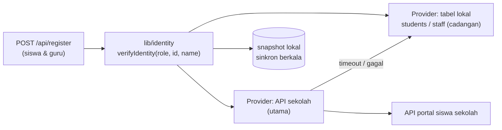
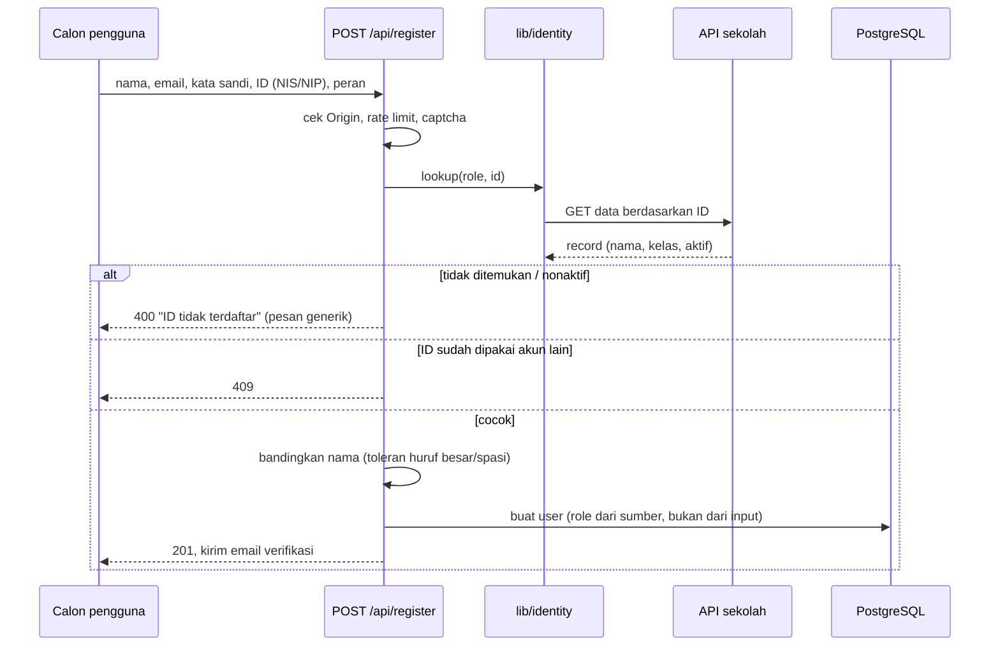

# Rekomendasi: Validasi Identitas Siswa dan Guru

> **Status: usulan.** Belum diimplementasikan. Bagian bertanda **[perlu konfirmasi]** bergantung pada jawaban sekolah/pusat data dan harus dipastikan sebelum pengembangan dimulai.

## 1. Kondisi saat ini

| | Siswa | Guru |
| --- | --- | --- |
| Pembuatan akun | Registrasi mandiri di `/register` | **Dibuat manual oleh admin** di panel CMS |
| Validasi | NIS harus ada di collection `students` (`users.nis` memeriksa lewat hook di `collections/Users.ts`) | Tidak ada; admin yang menentukan |
| Sumber data | Admin mengisi/mengimpor collection `students` (nis, nama, kelas) | Tidak ada daftar resmi di sistem |

Beban admin: setiap siswa baru, kenaikan kelas, pindah kelas, dan setiap guru baru harus dimasukkan manual, dan data bisa tertinggal dari sistem sekolah.

## 2. Tujuan

1. Guru dapat mendaftar sendiri; validasi memakai nomor identitas pendidik, bukan akun buatan admin.
2. Siswa tervalidasi lewat Nomor Induk Siswa terhadap **sumber data sekolah**, tanpa admin mengisi `students` manual.
3. Data kelas, program, dan status aktif/lulus selalu mengikuti sumber resmi.

## 3. Pilihan identitas yang perlu dikonfirmasi

| Identitas | Keterangan | Catatan |
| --- | --- | --- |
| **NIS** | Nomor Induk Siswa, diterbitkan sekolah | Unik per sekolah. Dipakai sekarang |
| **NISN** | Nomor Induk Siswa Nasional (10 digit) | Unik nasional; lebih tepat bila sekolah punya banyak sistem **[perlu konfirmasi: mana yang tersedia di API sekolah]** |
| **NIP** | Nomor Induk Pegawai (internal yayasan/sekolah) | Cocok bila guru swasta punya NIP yayasan |
| **NUPTK** | Nomor Unik Pendidik dan Tenaga Kependidikan (nasional) | Dipakai di data pusat; tidak semua guru punya **[perlu konfirmasi]** |

**Rekomendasi:** simpan satu field identitas utama per peran (`nis` untuk siswa, `employeeID` untuk guru), plus field opsional untuk identitas nasional (NISN/NUPTK). Putuskan satu identitas yang dijamin ada di sumber data (cukup satu yang konsisten, jangan campur). Pertanyaan ke pihak sekolah:

- Guru memakai NIP yayasan atau NUPTK sebagai ID resmi? Apakah semua guru pasti punya?
- Sistem apa yang menyimpan data guru dan siswa (aplikasi akademik sekolah, Dapodik, atau lainnya)?
- Apakah sistem itu memiliki API (REST/JSON) atau hanya ekspor berkas?
- Bagaimana autentikasi API-nya (API key, OAuth, IP whitelist)? Siapa pemilik kuncinya?
- Apakah boleh dipanggil dari internet (Vercel) atau hanya dari jaringan sekolah?

## 4. Arsitektur usulan: lapisan "Identity Provider" yang dapat ditukar

Jangan menanam API sekolah langsung di route registrasi. Buat satu antarmuka sehingga sumber data bisa diganti (tabel lokal, API sekolah, CSV) tanpa mengubah alur registrasi.



Kontrak yang disarankan:

```ts
// lib/identity/types.ts
export type IdentityRecord = {
  id: string                 // NIS (siswa) atau NIP/NUPTK (guru)
  name: string
  role: 'student' | 'teacher'
  className?: string         // siswa
  programCode?: string       // siswa/guru
  active: boolean            // false = lulus/keluar/nonaktif
}
export interface IdentityProvider {
  lookup(role: 'student' | 'teacher', id: string): Promise<IdentityRecord | null>
}
```

Pemilihan provider lewat environment variable (`IDENTITY_PROVIDER=school-api|local`), sehingga lingkungan development tetap berjalan tanpa API sekolah.

## 5. Alur registrasi usulan



Aturan yang disarankan:

1. **Peran ditentukan oleh sumber data**, bukan oleh pilihan pengguna. Pendaftar yang ID-nya ditemukan di data guru otomatis menjadi guru. Ini mencegah siswa mendaftar sebagai guru.
2. **Verifikasi kepemilikan.** Mengetahui NIS/NIP saja tidak membuktikan pemilik (NIS mudah ditebak). Tambahkan salah satu:
   - cocokkan **tanggal lahir** atau 4 digit terakhir NIK/nomor HP yang ada di data sekolah, atau
   - kirim **kode/tautan verifikasi** ke email sekolah atau nomor HP yang tercatat di sumber data (bukan email yang diketik pendaftar), atau
   - guru: persetujuan admin sekali (antrean "menunggu persetujuan") sebagai pengaman awal.
3. **Satu ID satu akun** (unique index pada `nis` / `employeeID`).
4. **Pesan error generik** agar tidak bisa dipakai menebak ID yang valid (enumeration).
5. Batasi percobaan per IP dan per ID (lihat [REKOMENDASI-KEAMANAN.md](REKOMENDASI-KEAMANAN.md)).

Untuk guru, sebelum API tersedia, ada jalur bertahap yang aman:

| Tahap | Cara | Beban admin |
| --- | --- | --- |
| 1 | Admin mengunggah **CSV daftar guru** (ID, nama, program) ke collection `staff`; guru mendaftar sendiri dan divalidasi terhadap `staff` | Unggah sekali per semester |
| 2 | Sinkronisasi terjadwal dari API sekolah mengisi `staff` otomatis | Nol |
| 3 | Validasi langsung ke API saat registrasi (tanpa tabel perantara) | Nol |

## 6. Sinkronisasi data dari API portal siswa

Dua pola, bisa digabung:

| Pola | Cara | Kelebihan | Kekurangan |
| --- | --- | --- | --- |
| **Cek langsung (on-demand)** | Panggil API saat registrasi/login | Selalu terbaru, tanpa salinan data | Registrasi gagal bila API sekolah mati; menambah latensi |
| **Sinkron terjadwal (snapshot)** | Cron mengambil data siswa/guru ke tabel lokal | Cepat, tahan gangguan, bisa dipakai untuk relasi kelas | Data bisa tertinggal sampai sinkron berikutnya |

**Rekomendasi:** snapshot terjadwal sebagai sumber utama (harian atau saat jam sepi), plus cek langsung hanya untuk ID yang belum ada di snapshot. Dengan begitu collection `students` tetap ada tetapi **diisi mesin, bukan admin**.

Yang ikut disinkronkan:

- Kelas dan program siswa (menggantikan penetapan manual; saat naik kelas, `users.class` ikut berubah — termasuk keanggotaan ruang chat kelas yang diturunkan dari kelas).
- Status aktif: siswa lulus/keluar dapat diberi status `alumni` atau `nonaktif` (tidak ikut dihapus; karya tetap tersimpan).
- Guru: program/kelas binaan yang dipakai untuk **cakupan verifikasi karya** (saat ini dari `users.class` dan `users.program`).

Implementasi di Vercel: Cron Jobs (`vercel.json` `crons`) memanggil route terlindungi (`/api/internal/sync-identities`, dijaga secret `CRON_SECRET`). Untuk data besar, proses per halaman dan upsert berdasarkan ID.

## 7. Keamanan integrasi

- Kunci API sekolah hanya di environment variable server; tidak pernah dikirim ke browser.
- Panggilan hanya dari server (route handler/cron), dengan timeout (mis. 5 detik) dan retry terbatas.
- Jika API sekolah hanya dapat diakses dari jaringan internal, pasang **gateway kecil** di sekolah (reverse proxy dengan API key atau Tailscale/Cloudflare Tunnel) alih-alih membuka API internal ke internet.
- Minimalkan data: ambil hanya kolom yang dibutuhkan (ID, nama, kelas, status). Jangan menyalin NIK, alamat, atau data sensitif lain. Patuhi UU Pelindungan Data Pribadi; siswa di bawah umur membutuhkan dasar hukum/persetujuan sekolah.
- Catat (log audit) setiap pencocokan identitas yang berhasil/gagal tanpa menyimpan data pribadi berlebih.

## 8. Dampak pada kode (perkiraan pekerjaan)

| Perubahan | Berkas |
| --- | --- |
| Antarmuka dan provider | `lib/identity/*` (baru) |
| Registrasi memakai provider, peran dari sumber | `app/(payload)/api/register/route.ts`, `app/(site)/register/page.tsx` |
| Field `employeeID` (dan opsional `nisn`/`nuptk`) + unique index + migrasi | `collections/Users.ts`, `migrations/` |
| Hook `nis` tidak lagi hanya memeriksa `students` lokal | `collections/Users.ts` |
| Tabel `staff` (opsional, tahap 1-2) | `collections/Staff.ts` + migrasi (jangan lupa kolom `payload_locked_documents_rels`) |
| Cron sinkronisasi | `app/(payload)/api/internal/sync-identities/route.ts`, `vercel.json` |
| Status akun (`active`/`alumni`) memengaruhi login | `lib/websiteAuth.ts` |
| Test | registrasi guru valid/tidak valid, peran dipaksa dari sumber, ID ganda, provider gagal → fallback |

## 9. Rencana bertahap

1. Konfirmasi ke sekolah (daftar pertanyaan bagian 3) dan minta dokumentasi API + akses uji.
2. Buat `lib/identity` dengan provider lokal (perilaku saat ini) dan uji.
3. Tambah registrasi guru dengan tabel `staff` dari CSV + persetujuan admin.
4. Tambah provider API sekolah + sinkron terjadwal; matikan input manual `students`.
5. Tambah verifikasi kepemilikan (kode ke email/HP resmi) dan hapus persetujuan manual bila data sudah dipercaya.
