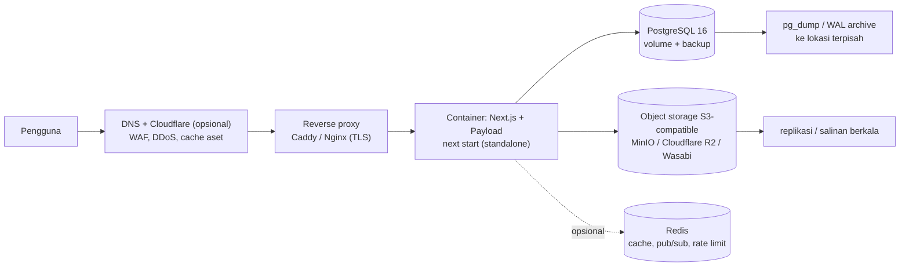
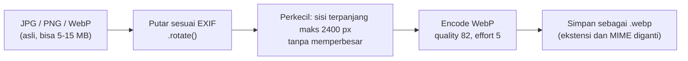

# Rekomendasi: Migrasi Hosting, Storage, dan Database

> **Status: panduan dan usulan.** Belum ada migrasi yang dijalankan. Angka kapasitas adalah perkiraan; ukur dengan data nyata sebelum memilih spesifikasi server.

## 1. Kondisi saat ini

| Komponen | Sekarang | Ketergantungan platform |
| --- | --- | --- |
| Aplikasi | Next.js 16 di Vercel Serverless (region `hnd1`) | `vercel.json`; tidak ada fitur Vercel lain yang dipakai kode |
| Database | PostgreSQL di Supabase lewat pooler transaction mode (:6543) | Hanya PostgreSQL standar; tidak memakai Supabase Auth/Storage/Realtime/RLS |
| File upload | Vercel Blob lewat `@payloadcms/storage-vercel-blob` | Plugin Blob + kolom `_objectkey` di tabel `uploads` |
| Cache | Memori per instance (leaderboard) + header `Cache-Control` | Tidak ada Redis |
| Background job | Tidak ada | - |

Kabar baiknya: **kode tidak terkunci ke vendor**. Database adalah PostgreSQL biasa, aplikasi adalah Node.js biasa, dan satu-satunya adapter spesifik vendor adalah storage (mudah diganti, lihat bagian 4).

## 2. Opsi hosting

| Opsi | Cocok untuk | Kelebihan | Kekurangan |
| --- | --- | --- | --- |
| **A. Tetap Vercel + Supabase** | Operasional minim | Tanpa kelola server, deploy otomatis | Biaya berjalan, data di luar kendali sekolah, polling (tidak ada WebSocket persisten) |
| **B. VPS/cloud (Docker) + PostgreSQL sendiri** | Sekolah ingin kendali, tim punya satu orang yang mengelola server | Biaya tetap, WebSocket mudah, tanpa batas durasi fungsi | Perlu mengurus backup, patch, monitoring, TLS |
| **C. Server sekolah (on-premise)** | Kebijakan data harus di sekolah | Data sepenuhnya milik sekolah, akses LAN cepat | Perlu IP publik/tunnel, listrik dan jaringan andal, UPS, backup luar lokasi |
| **D. Hibrida** | Transisi bertahap | Aplikasi di server sekolah/VPS, storage di R2/S3, DB dikelola | Lebih banyak bagian yang dipantau |

**Rekomendasi:** mulai dari **B atau D** (VPS dengan Docker Compose), karena memungkinkan WebSocket ([REKOMENDASI-REALTIME.md](REKOMENDASI-REALTIME.md)) dan tidak ada batas durasi fungsi. Pilih **C** hanya bila sekolah punya infrastruktur dan personel yang menjaga uptime; jika dipilih, wajib ada backup di luar gedung.

### Topologi self-hosted yang disarankan



Komponen minimum: 1 server (mulai 2 vCPU / 4 GB RAM sebagai titik awal pengujian), Docker Compose berisi `app` + `postgres` + `caddy`. Redis ditambahkan bila memakai WebSocket multi-proses atau rate limiting terdistribusi.

## 3. Perubahan kode untuk berpindah dari Vercel

| Hal | Tindakan |
| --- | --- |
| Output build | Tambah `output: 'standalone'` di `next.config.ts`, jalankan `node server.js` di container |
| `vercel.json` (region) | Tidak dipakai; hapus atau abaikan |
| Storage | Ganti plugin Vercel Blob dengan adapter S3 (bagian 4) atau disk lokal |
| `DATABASE_URL` | Server panjang umur boleh koneksi langsung (:5432) tanpa pooler transaction mode; atur `DATABASE_POOL_MAX` sesuai `max_connections` PostgreSQL |
| Cache memori leaderboard | Lebih efektif di satu proses panjang; pakai Redis bila nanti lebih dari satu instance |
| Cron | Ganti Vercel Cron dengan cron host / container `ofelia` / `node-cron` yang memanggil route internal |
| Environment | Pindahkan variabel ke `.env` server atau secret manager; `NEXT_PUBLIC_SERVER_URL` diganti domain baru |
| `Origin` check pada login/register | Pastikan reverse proxy meneruskan `Host`/`X-Forwarded-*` dengan benar agar `new URL(request.url).origin` sama dengan origin browser |

Contoh `Dockerfile` ringkas (sketsa, uji sebelum dipakai):

```dockerfile
FROM node:22-alpine AS build
WORKDIR /app
COPY package*.json ./
RUN npm ci
COPY . .
RUN npm run build

FROM node:22-alpine
WORKDIR /app
ENV NODE_ENV=production
COPY --from=build /app/.next/standalone ./
COPY --from=build /app/.next/static ./.next/static
COPY --from=build /app/public ./public
EXPOSE 3000
CMD ["node", "server.js"]
```

## 4. Storage berkas

### 4.1 Cara kerja sekarang

- Unggahan melewati `collections/Uploads.ts`, lalu diteruskan ke Vercel Blob oleh plugin.
- Bila `BLOB_READ_WRITE_TOKEN` kosong, plugin nonaktif dan berkas disimpan di `public/media` (hanya cocok untuk lokal).
- Browser memuat gambar langsung dari URL Blob.

### 4.2 Kompresi gambar (sudah ada)

Setiap gambar yang diunggah diproses di hook `beforeOperation` sebelum disimpan:



| Parameter | Nilai | Dampak |
| --- | --- | --- |
| Format keluaran | WebP | Umumnya 25-35% lebih kecil dari JPEG pada kualitas setara; jauh lebih kecil dari PNG untuk foto |
| Resolusi maksimum | 2400 × 2400 px (`fit: inside`) | Foto kamera 4000-6000 px turun drastis; layar 4K tetap tajam |
| Kualitas | 82 | Perbedaan visual hampir tidak terlihat; ukuran turun signifikan dibanding 90+ |
| Gambar kecil | tidak diperbesar (`withoutEnlargement`) | Tidak ada pemborosan |
| Orientasi | diputar sesuai EXIF lalu metadata dibuang | Foto ponsel tidak miring, dan lokasi GPS dalam EXIF ikut terhapus (privasi) |
| Teks alt | dibuat otomatis bila kosong | Aksesibilitas, tanpa beban admin |

Perkiraan penghematan (angka kasar, bergantung isi gambar): foto ponsel 4-8 MB biasanya menjadi sekitar 0,3-1 MB; tangkapan layar PNG 2-4 MB menjadi sekitar 0,1-0,4 MB. **Ukur** dengan membandingkan total ukuran `uploads` sebelum/sesudah pada sampel nyata sebelum membuat klaim kapasitas.

**Yang belum dikompresi / kesenjangan:**

| Kesenjangan | Dampak | Usulan |
| --- | --- | --- |
| Video (`mp4`, `webm`) dan PDF disimpan apa adanya | Penyumbang terbesar storage | Batasi ukuran unggahan (mis. video maks 50-100 MB, PDF maks 10 MB); sarankan tautan YouTube/Drive untuk video panjang; opsi transcoding (bagian 4.4) |
| Hanya satu ukuran gambar per berkas (sampai 2400 px) | Kartu daftar memuat gambar besar untuk tampilan kecil → boros bandwidth | Hasilkan varian (mis. 400/800/1600 px) lewat `imageSizes` Payload atau `next/image` loader; muat varian kecil di kartu |
| Tidak ada pembersihan berkas yatim | Berkas yang tak lagi dipakai tetap tersimpan | Skrip berkala: cari `uploads` tanpa referensi dari tabel lain, lalu hapus setelah masa tenggang |
| Tidak ada kuota per pengguna | Satu akun dapat mengunggah tanpa batas | Batas jumlah/ukuran per pengguna dan batas laju unggahan |
| Cache CDN gambar | Browser memuat ulang dari origin | Atur `Cache-Control: public, max-age=31536000, immutable` (nama berkas unik) |

Opsi peningkatan kompresi: AVIF (lebih kecil dari WebP namun encode lebih lambat dan dukungan lama terbatas), atau menurunkan batas ke 1920 px bila tampilan tidak membutuhkan lebih.

### 4.3 Pilihan penyimpanan baru

| Opsi | Kelebihan | Kekurangan |
| --- | --- | --- |
| **Cloudflare R2** (S3-compatible) | Tanpa biaya egress, murah, CDN bawaan | Layanan eksternal |
| **MinIO di server sendiri** | Data di bawah kendali sekolah, S3-compatible | Perlu disk, backup, dan pemantauan sendiri |
| **Supabase Storage** (S3-compatible) | Satu vendor dengan DB bila tetap di Supabase | Tetap bergantung vendor |
| **Disk lokal** (`public/media` atau volume) | Paling sederhana | Tidak skala ke banyak instance; backup manual; tanpa CDN |

Pendekatan teknis: ganti `@payloadcms/storage-vercel-blob` dengan `@payloadcms/storage-s3` (kompatibel R2/MinIO/Wasabi) pada `payload.config.ts`, dengan endpoint, bucket, dan kredensial dari environment variable. Karena hook kompresi bekerja sebelum penyimpanan, tidak perlu diubah.

### 4.4 Memigrasi berkas yang sudah ada

1. Daftar semua berkas: `SELECT id, filename, url, "_objectkey" FROM uploads` (kolom `_objectkey` berasal dari plugin Blob; verifikasi nama kolom sebenarnya di database).
2. Unduh semua objek dari Vercel Blob (API `list` + `fetch`) dan unggah ke bucket baru dengan **nama/key yang sama** bila memungkinkan.
3. Perbarui kolom `url` di tabel `uploads` atau, lebih baik, pastikan URL dihasilkan dari konfigurasi adapter baru sehingga tidak perlu menulis ulang data. **[perlu diuji]** Payload bisa menyimpan `url` penuh di database untuk beberapa adapter; periksa dengan satu berkas sebelum migrasi massal.
4. Uji dengan salinan database (bukan produksi): buka beberapa halaman karya dan profil, pastikan gambar muncul.
5. Cutover: bekukan unggahan sebentar, sinkronkan selisih terakhir, ubah konfigurasi, deploy.
6. Simpan Blob lama sekurangnya beberapa minggu sebagai cadangan sebelum dihapus.

### 4.5 Video

Bila video bertambah banyak: gunakan penyimpanan terpisah dengan transcoding (mis. `ffmpeg` worker yang mengubah ke H.264 720p 1-2 Mbps) atau arahkan pengguna menautkan video dari layanan eksternal. Jangan melayani video besar dari proses Next.js.

## 5. Database

### 5.1 Memindahkan PostgreSQL

Karena hanya fitur PostgreSQL standar yang dipakai, perpindahan cukup dump dan restore:

```bash
# 1) dari mesin yang bisa mengakses DB lama (gunakan session pooler/direct, bukan transaction pooler)
pg_dump --format=custom --no-owner --no-privileges "$OLD_DATABASE_URL" -f portal.dump

# 2) di server baru
createdb telkom_portal
pg_restore --no-owner --no-privileges -d telkom_portal portal.dump

# 3) arahkan DATABASE_URL, lalu cek status migrasi Payload
npm run payload -- migrate:status
```

Catatan:

- Tabel `payload_migrations` ikut terbawa, sehingga `migrate:status` seharusnya menunjukkan semua migrasi sudah dijalankan. Jangan jalankan `migrate` pada hasil restore sebelum memeriksanya.
- Pastikan versi PostgreSQL tujuan sama atau lebih baru dari sumber.
- Periksa ekstensi: `SELECT extname FROM pg_extension;` dan pasang yang sama di server baru. Skema aplikasi tidak memakai ekstensi khusus Supabase, tetapi dump dari Supabase dapat memuat skema internal (`auth`, `storage`, ...) yang tidak diperlukan; gunakan `--schema=public` untuk membatasi.
- Beda zona waktu/locale/collation dapat memengaruhi pengurutan; samakan.

### 5.2 Rencana cutover dengan downtime singkat

1. Siapkan server baru, restore dump uji, jalankan aplikasi terhadapnya, dan jalankan `npm test` terhadap salinan itu.
2. Hari-H: mode pemeliharaan (atau hentikan aplikasi lama) → dump final → restore → ubah DNS/`DATABASE_URL` → nyalakan aplikasi baru → verifikasi.
3. Rollback: aplikasi lama dan database lama tetap utuh sampai verifikasi selesai; kembalikan DNS bila gagal.

Untuk nol downtime (replikasi logis) diperlukan pengaturan `wal_level=logical` dan publikasi/langganan; untuk sekolah biasanya downtime 10-30 menit di luar jam sekolah sudah cukup.

### 5.3 Operasional database sendiri

| Aspek | Saran |
| --- | --- |
| Backup | `pg_dump` harian + simpan 7 harian/4 mingguan/6 bulanan; idealnya WAL archiving (pgBackRest/WAL-G) untuk pemulihan titik waktu |
| Lokasi backup | **Berbeda** dari server utama (object storage lain atau mesin lain) |
| Uji pemulihan | Restore ke mesin uji minimal sekali per semester; backup yang tidak pernah diuji belum bisa dianggap ada |
| Koneksi | Atur `max_connections` ≥ `DATABASE_POOL_MAX` × jumlah proses + cadangan admin; gunakan PgBouncer bila banyak proses |
| Pemantauan | Ruang disk, koneksi aktif, query lambat (`pg_stat_statements`), lag replikasi bila ada |
| Pembaruan | Patch minor rutin; mayor upgrade direncanakan dengan dump/restore |
| Akses | Port 5432 tidak dibuka ke internet; hanya jaringan privat atau tunnel |

## 6. Checklist migrasi

- [ ] Putuskan opsi hosting (bagian 2) dan siapa yang bertanggung jawab operasional.
- [ ] Siapkan domain, DNS, TLS (Caddy mengurus sertifikat otomatis).
- [ ] Bangun image Docker dan uji `next build` + `node server.js` secara lokal.
- [ ] Tentukan storage tujuan; ganti adapter; uji unggah, crop, dan tampil.
- [ ] Salin berkas lama; verifikasi sampel halaman.
- [ ] Dump/restore database ke lingkungan uji; jalankan `migrate:status`, `npm test`, dan uji manual alur utama (login, buat karya, verifikasi, chat, tracker).
- [ ] Siapkan cron (sinkronisasi identitas, pembersihan berkas yatim).
- [ ] Siapkan backup otomatis dan uji pemulihan.
- [ ] Siapkan pemantauan (uptime, error log, disk) dan peringatan.
- [ ] Jadwalkan cutover di luar jam sekolah; siapkan rencana rollback.
- [ ] Setelah stabil: matikan layanan lama bertahap, simpan arsip.
