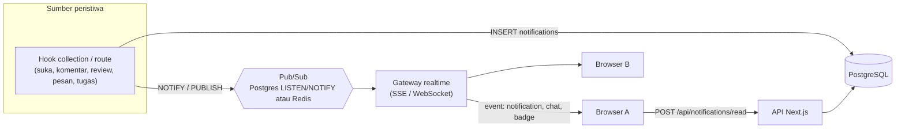

# Rekomendasi: Notifikasi Realtime dan Status Baca di Server

> **Status: usulan.** Belum diimplementasikan.

## 1. Kondisi saat ini

| Aspek | Sekarang | Masalah |
| --- | --- | --- |
| Pengiriman | Polling berkala ke `POST /api/portal/pulse` (notifikasi + chat belum dibaca + badge tracker); chat memakai `GET .../messages?after=ID` | Penundaan sebesar interval polling; setiap tab terbuka menembak database terus-menerus |
| Daftar notifikasi | **Diturunkan dari status data** saat diminta (revisi karya, undangan, suka/komentar baru, tenggat) — tidak ada tabel notifikasi | Tidak bisa menyimpan riwayat, tidak ada notifikasi untuk peristiwa yang tidak meninggalkan jejak status |
| Status "sudah dibaca" | `localStorage` per browser (`components/WorkspaceNotifications.tsx`, maks 200 ID) | Tidak ikut berpindah perangkat; hilang saat data browser dibersihkan; badge berbeda antar perangkat |
| Chat belum dibaca | Sudah di server (`chat_members.last_read_id`) | - |
| Tracker "aktivitas baru" | `localStorage` (`lib/trackerSeen.ts`) | Sama seperti notifikasi |

Tujuan: **tidak ada lagi localStorage untuk status baca**, dan pembaruan hampir seketika tanpa polling berat.

## 2. Bagian 1: tabel notifikasi (prasyarat, tanpa WebSocket)

Menyimpan notifikasi sebagai data adalah dasar untuk semuanya, termasuk status baca di server.

### Skema usulan

`notifications`

| Kolom | Tipe | Keterangan |
| --- | --- | --- |
| `id` | serial PK | |
| `user_id` | FK `users`, indeks | penerima |
| `type` | text | `portfolio.revision`, `portfolio.verified`, `comment.new`, `like.new`, `project.invite`, `project.invite.response`, `opportunity.interest`, `award.closing`, `record.earned`, `chat.mention`, ... |
| `title`, `body` | text | teks siap tampil (atau kunci i18n + `data`) |
| `href` | text | tujuan klik |
| `data` | jsonb | ID terkait (karya, proyek, pelaku) |
| `dedupe_key` | text UNIQUE | mencegah ganda, mis. `like:{portfolio}:{user}` |
| `actor_id` | FK `users`, nullable | pelaku |
| `read_at` | timestamptz, nullable | **status baca di server** |
| `created_at` | timestamptz | |

Indeks: `(user_id, read_at, created_at DESC)` untuk "belum dibaca terbaru" dan jumlah badge.

### Endpoint

| Method | Path | Fungsi |
| --- | --- | --- |
| GET | `/api/notifications?cursor=&unread=1` | Daftar (paginasi kursor) + `unreadCount` |
| POST | `/api/notifications/read` | `{ ids: [...] }` atau `{ all: true }` → set `read_at = now()` |
| POST | `/api/notifications/[id]/read` | Tandai satu |
| DELETE | `/api/notifications/[id]` | Hapus/sembunyikan satu (opsional) |

`/api/portal/pulse` mengembalikan `unreadCount` dari tabel ini, bukan menghitung ulang dari status.

### Pembuatan notifikasi (event → baris)

Buat helper `notify(userIDs, { type, ... })` dan panggil dari tempat peristiwa terjadi (hook collection atau route):

| Peristiwa | Tempat | Penerima |
| --- | --- | --- |
| Suka/komentar karya | hook `afterChange` `portfolio-likes` / `portfolio-comments` | pemilik karya (bukan pelaku) |
| Revisi diminta / karya terverifikasi | `POST /api/mentor/reviews` | siswa pemilik |
| Karya diajukan | hook `portfolios` saat `submitted` | guru dalam cakupan |
| Undangan/respons pembimbing proyek | `projects/[id]/actions` | guru / pengelola |
| Minat peluang | hook `opportunity-interests` | guru dalam cakupan |
| Pencapaian baru | pembuatan `student-records` | siswa |
| Tenggat dekat (peluang/voting) | cron harian | siswa yang relevan |
| Tugas ditugaskan / komentar tugas | `tracker/*` | penanggung jawab |

Gunakan `dedupe_key` + `ON CONFLICT DO NOTHING` agar suka berulang (toggle) tidak membanjiri. Pertimbangkan **agregasi** ("5 orang menyukai karyamu") dengan memperbarui baris yang sama dalam jendela waktu.

### Migrasi dari kondisi sekarang

1. Tambah tabel dan endpoint; biarkan penurunan-dari-status tetap berjalan sebagai cadangan.
2. Isi awal (backfill) opsional dari status saat ini, ditandai terbaca agar tidak membanjiri.
3. Ubah `WorkspaceNotifications.tsx` memakai `/api/notifications`; hapus pembacaan/penulisan `localStorage` untuk status baca.
4. Hapus logika penurunan-dari-status di `portal/notifications/route.ts` setelah stabil.
5. Pindahkan tanda "aktivitas baru" tracker ke server dengan cara serupa: tabel `tracker_reads(user_id, project_id, last_seen_at)` menggantikan `lib/trackerSeen.ts`.

## 3. Bagian 2: pengiriman realtime

### 3.1 Pilihan teknologi

| Opsi | Cara | Cocok bila | Catatan |
| --- | --- | --- | --- |
| **Server-Sent Events (SSE)** | `GET /api/stream` mengalirkan event satu arah server → klien | Notifikasi, badge, pesan masuk; hosting self-hosted | Paling sederhana; otomatis menyambung ulang; lewat HTTP biasa; kirim pesan tetap lewat POST yang sudah ada |
| **WebSocket** (`ws`/Socket.IO) | Koneksi dua arah persisten | Indikator mengetik, presence akurat, kolaborasi langsung | Perlu server yang panjang umur (bukan serverless) |
| **Layanan terkelola** (Supabase Realtime, Pusher, Ably) | Server memublikasikan, klien berlangganan | Tetap di Vercel serverless | Biaya per koneksi/pesan; data lewat pihak ketiga |
| **Polling adaptif** | Interval 5 dtk saat aktif, 60 dtk saat tab tersembunyi/idle | Tidak ada perubahan infrastruktur | Peningkatan tercepat dan murah sebagai langkah antara |

**Rekomendasi:**

- Bila tetap di Vercel serverless: gunakan **layanan terkelola** (atau polling adaptif) karena fungsi serverless tidak cocok menahan koneksi WebSocket/SSE panjang.
- Bila pindah ke VPS/server sekolah ([REKOMENDASI-MIGRASI.md](REKOMENDASI-MIGRASI.md)): **SSE untuk notifikasi dan badge**, dan **WebSocket hanya untuk chat** (mengetik, status online). Mulailah dengan SSE; WebSocket ditambah bila memang butuh dua arah.

### 3.2 Arsitektur dengan server panjang umur



- **Satu instance**: bus cukup di memori proses.
- **Lebih dari satu instance**: gunakan Postgres `LISTEN/NOTIFY` (tanpa komponen baru) atau Redis pub/sub, supaya peristiwa sampai ke instance tempat pengguna terhubung.
- **Sumber kebenaran tetap database.** Event realtime hanyalah sinyal "ada yang baru"; klien boleh mengambil ulang lewat API. Dengan begitu pesan yang terlewat (koneksi putus) pulih saat tersambung kembali: klien mengirim `Last-Event-ID`/`after` lalu server mengirim yang tertinggal.

### 3.3 Protokol event (usulan)

```text
event: notification      data: { id, type, title, href, createdAt }
event: unread            data: { notifications: 3, chat: 5, tracker: 2 }
event: chat.message      data: { conversationId, message }
event: chat.typing       data: { conversationId, userId }     (WebSocket)
event: presence          data: { userId, online }
```

Autentikasi: cookie sesi yang sama (`karyakita-session`) divalidasi saat koneksi dibuka; periksa juga header `Origin`. Jangan menaruh token di URL. Batasi koneksi per pengguna (mis. 5 tab) dan kirim heartbeat berkala agar koneksi mati dapat dibersihkan.

### 3.4 Dampak pada fitur yang ada

| Fitur | Perubahan |
| --- | --- |
| `/api/portal/pulse` | Dipertahankan sebagai cadangan (fallback) saat SSE/WS gagal; frekuensi diturunkan jadi 60 dtk |
| Chat | Pesan masuk lewat event; `GET messages?after=` hanya untuk pemulihan; indikator "mengetik" |
| Presence | Online/offline dari status koneksi, bukan heartbeat DB tiap interval (mengurangi tulis ke `users.last_seen_at`) |
| Suara notifikasi | Tetap Web Audio; dipicu event |
| Notifikasi push saat tab ditutup | Tambahkan Web Push (service worker + VAPID); opt-in di pengaturan |

### 3.5 Tahapan

1. Tabel `notifications` + endpoint baca + hapus `localStorage` untuk status baca (bagian 2).
2. Polling adaptif (interval mengikuti visibilitas tab) — cepat dan murah.
3. SSE untuk `unread` dan `notification` (setelah pindah ke server panjang umur atau memakai layanan terkelola).
4. WebSocket untuk chat (mengetik, presence) bila dibutuhkan.
5. Web Push untuk notifikasi saat tab ditutup.

### 3.6 Pengujian

- Test unit helper `notify` (dedupe, penerima benar, bukan pelaku).
- Test route `read` (hanya milik sendiri, idempoten).
- Test integrasi event → baris notifikasi untuk tiap peristiwa pada tabel di atas.
- Uji beban sederhana: jumlah koneksi SSE per proses dan penggunaan memori.
