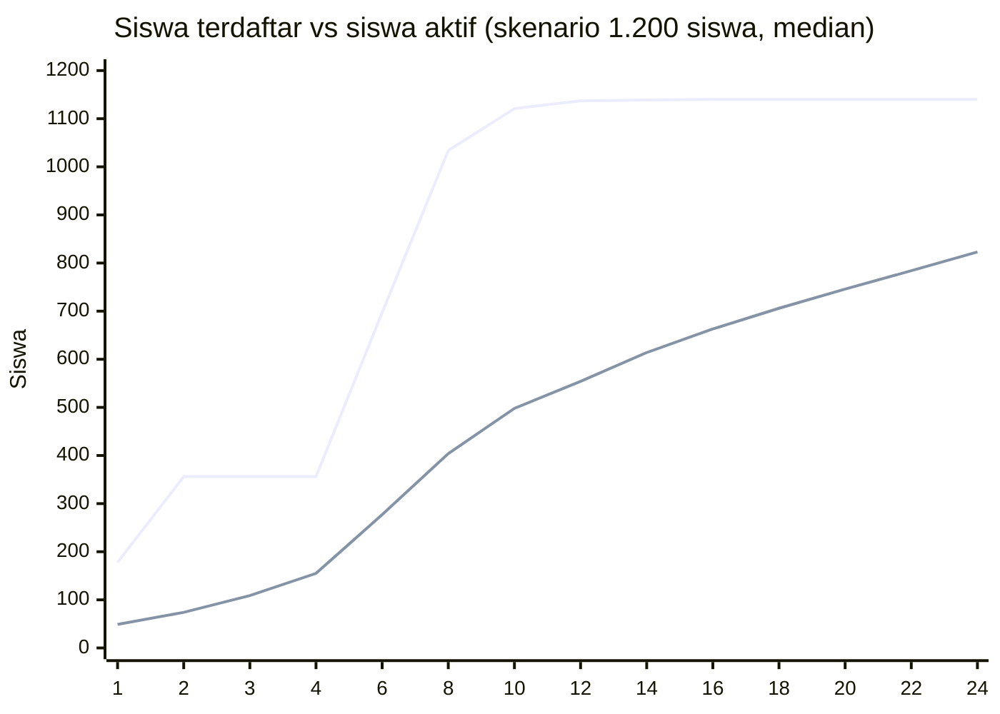

# Simulasi Adopsi dan Kebutuhan Sumber Daya

Simulasi untuk sekolah berskala SMK Telkom: berapa siswa yang akan aktif, berapa karya dan proyek yang terkumpul, berapa storage, database, dan beban server yang dibutuhkan, serta beban kerja guru. Angka dipakai sebagai dasar [PROPOSAL.md](PROPOSAL.md) bagian 8.6 dan 10.

> **Penting – ini simulasi, bukan data sekolah.** Pencarian publik tidak menemukan angka resmi jumlah siswa, rombongan belajar, dan guru SMK Telkom yang dapat diverifikasi (data pasti ada di Dapodik atau pihak yayasan). Karena itu simulasi memakai **tiga ukuran sekolah** (800, 1.200, 1.800 siswa) sebagai rentang. Semua parameter perilaku (berapa karya per siswa, ukuran file, dan sebagainya) adalah **asumsi perencanaan** yang dibuat penulis, bukan hasil pengukuran. Ganti dengan data sekolah lalu jalankan ulang skripnya.

## 1. Cara kerja

| Aspek | Penjelasan |
| --- | --- |
| Skrip | [`scripts/simulate-adoption.py`](../scripts/simulate-adoption.py), hanya pustaka standar Python |
| Menjalankan | `python3 scripts/simulate-adoption.py` (tabel ringkas) atau `--json` (data lengkap) |
| Model | Per bulan selama 24 bulan ajaran. Percontohan 3 bulan (±sepertiga sekolah), seluruh sekolah mulai bulan ke-4. Kurva adopsi berbentuk S (logistik) dengan batas maksimum siswa aktif |
| Ketidakpastian | **Monte Carlo 2.000 kali** per skenario; tiap parameter diambil dari sebaran segitiga (minimum, paling mungkin, maksimum) sehingga hasil berupa rentang |
| Keterulangan | Benih acak tetap (`20261018`), hasil sama setiap dijalankan |
| Laporan | **P50** = nilai tengah, **P10–P90** = rentang 80% hasil simulasi |

Bulan ke-6 dan ke-12 dianggap libur/ujian (aktivitas 35%).

## 2. Skenario ukuran sekolah

| Skenario | Siswa | Rombel (±33/kelas) | Guru (±1:13) |
| --- | --- | --- | --- |
| Kecil | 800 | 24 | 60 |
| **Sedang (acuan)** | **1.200** | **36** | **90** |
| Besar | 1.800 | 54 | 130 |

## 3. Parameter (asumsi)

| Parameter | Terendah / paling mungkin / tertinggi |
| --- | --- |
| Siswa aktif (≥1 karya terverifikasi) pada akhir tahun 1 | 35% / 50% / 65% |
| …pada akhir tahun 2 | 50% / 70% / 85% |
| Bulan titik tengah adopsi | ke-4,5 / ke-6 / ke-8,5 |
| Karya per siswa aktif per tahun | 0,8 / 1,5 / 2,5 |
| Karya yang akhirnya terverifikasi | 75% / 88% / 95% |
| Guru yang aktif memverifikasi | 30% / 50% / 70% |
| Siswa aktif yang ikut proyek tim (tim ±4 orang) | 10% / 20% / 30% |
| Gambar per karya | 3 / 5 / 8 |
| Ukuran gambar setelah kompresi WebP | median 0,5 MB (sebaran lognormal) |
| Karya yang menyertakan video | 3% / 10% / 20%, ukuran 15 / 35 / 50 MB |
| Karya yang menyertakan PDF | 3% / 10% / 20%, ukuran 1 / 4 / 10 MB |
| Siswa terdaftar yang aktif chat | 15% / 30% / 50%, 5 / 15 / 30 pesan per hari sekolah |
| Suka dan komentar per karya | 2 / 6 / 12 dan 0,5 / 2 / 5 |
| Pengguna terdaftar yang online saat jam puncak | 5% / 10% / 16% |
| Permintaan per detik per pengguna online | 0,06 / 0,10 / 0,16 (polling notifikasi tiap 25 detik ditambah halaman, chat, tracker) |

## 4. Hasil

Nilai P50 dengan rentang P10–P90 dalam kurung. "Karya" adalah karya terverifikasi kumulatif.

### 4.1 Skenario sedang – 1.200 siswa (acuan)

| Bulan | Terdaftar | Siswa aktif | Karya terverifikasi | Storage berkas | Database | Puncak online (±permintaan/dtk) |
| --- | --- | --- | --- | --- | --- | --- |
| 3 (akhir percontohan) | 356 | 109 (66–162) | 31 | 0,2 GB | 67 MB | 37 (±4) |
| 6 | 697 | 277 (192–367) | 93 | 0,7 GB | 124 MB | 72 (±7) |
| **12 (akhir tahun 1)** | **1.137** | **554 (463–647)** | **419** | **3,4 GB (1,9–5,7)** | **435 MB** | **117 (±12)** |
| **24 (akhir tahun 2)** | **1.140** | **823 (698–936)** | **1.442** | **11,6 GB (6,9–18,9)** | **1,1 GB** | **117 (±12)** |

Siswa aktif: 46% di akhir tahun 1 dan 69% di akhir tahun 2 dari seluruh siswa.

Lintasan median per bulan (acuan):

Garis atas: siswa terdaftar. Garis bawah: siswa aktif. Pendaftaran sempat datar pada bulan 3–4 karena percontohan baru berjalan di sepertiga sekolah sebelum seluruh sekolah dibuka.

### 4.2 Perbandingan tiga skala

| Ukuran | Aktif akhir tahun 1 | Aktif akhir tahun 2 | Karya (24 bln) | Storage (24 bln) | Database (24 bln) | Puncak online / permintaan per dtk |
| --- | --- | --- | --- | --- | --- | --- |
| Kecil (800) | 371 (308–432) | 548 | 961 | 7,9 GB (4,8–12,7) | 740 MB | 78 / ±8 |
| **Sedang (1.200)** | **554 (463–647)** | **823** | **1.442** | **11,6 GB (6,9–18,9)** | **1,1 GB** | **117 / ±12** |
| Besar (1.800) | 836 (696–980) | 1.232 | 2.177 | 17,8 GB (10,7–28,9) | 1,6 GB | 175 / ±18 |

### 4.3 Beban verifikasi guru

| | Karya diajukan per guru pembimbing per bulan |
| --- | --- |
| Rata-rata bulan puncak (P50) | **±2,8** |
| Bulan puncak, kasus ramai (P90) | **±4,1** |

Hampir sama di ketiga ukuran sekolah karena jumlah guru ikut membesar. Dengan 4 karya per bulan, bila tiap tinjauan 15–20 menit, beban sekitar 1–1,5 jam per bulan per guru; ini ringan. Risikonya bukan jumlah rata-rata, tetapi **penumpukan di akhir semester** ketika siswa mengajukan bersamaan; mitigasinya tenggat bertahap dan notifikasi/ringkasan mingguan.

### 4.4 Proyek tim

Pada skenario sedang, dengan 20% siswa aktif bergabung dalam tim ±4 orang, simulasi menghasilkan sekitar **23 proyek tim sampai akhir tahun 1** dan **±83 proyek kumulatif sampai akhir tahun 2** (median). Angka tepat bergantung pada kebijakan sekolah mengenai proyek wajib.

## 5. Penggerak utama (analisis sensitivitas, skenario sedang)

Satu parameter diubah, yang lain tetap pada sebaran dasar.

**Storage berkas pada bulan 24 (dasar: 11,7 GB):**

| Perubahan | Hasil |
| --- | --- |
| Video hanya 3% karya | 7,1 GB |
| Video 20% karya | 17,0 GB |
| Gambar rata-rata 0,25 MB | 9,2 GB |
| Gambar rata-rata 1 MB | 16,0 GB |
| 0,8 karya per siswa per tahun | 6,0 GB |
| 2,5 karya per siswa per tahun | 18,7 GB |

Video adalah penggerak storage terbesar yang dapat dikendalikan (batas ukuran dan arahan memakai tautan eksternal). Kompresi gambar sudah menekan sisanya.

**Database pada bulan 24 (dasar: 1,1 GB):**

| Perubahan | Hasil |
| --- | --- |
| Hanya 15% siswa aktif chat | 0,56 GB |
| 50% siswa aktif chat | 1,79 GB |

Pertumbuhan database didominasi **pesan chat**, bukan karya. Retensi pesan (misalnya arsipkan setelah satu tahun) menjaga ukuran tetap kecil.

**Siswa aktif pada bulan 24:** 600 bila batas tahun 2 hanya 50%, 1.020 bila 85%. Adopsi bergantung pada kebijakan sekolah lebih daripada teknologi.

## 6. Kebutuhan infrastruktur yang diturunkan

| Komponen | Skenario sedang | Catatan |
| --- | --- | --- |
| Storage berkas | ±4 GB akhir tahun 1; ±12 GB akhir tahun 2 (rentang 7–19 GB) | Rencanakan 25–30 GB untuk dua tahun dengan ruang aman |
| Database | <0,5 GB tahun 1; ±1,1 GB tahun 2 | Muat dalam paket database kecil |
| Beban puncak | ±120 pengguna online, ±12 permintaan/dtk; sekitar 60 kueri/dtk bila rata-rata 5 kueri per permintaan | Satu server 2 vCPU / 4 GB atau layanan serverless mencukupi |
| Total permintaan bulanan | ±5–6 juta per bulan | Hitungan kasar: 12 permintaan/dtk × 3.600 dtk × ±6 jam setara-puncak × ±22 hari; periksa batas paket hosting |
| Koneksi database | `DATABASE_POOL_MAX` × jumlah instance harus di bawah batas pooler | Lihat [ARCHITECTURE.md](ARCHITECTURE.md) |

### Perkiraan biaya bulanan (skenario sedang)

Kurs ±Rp 16.000 per USD; harga layanan sepengetahuan penulis, **periksa harga terkini**.

| Komponen | Opsi A: cloud terkelola | Opsi B: VPS sendiri |
| --- | --- | --- |
| Hosting aplikasi | ±US$ 20 | VPS 2 vCPU/4 GB ±Rp 200–450 rb |
| Database | ±US$ 25 | termasuk di VPS |
| Storage berkas (±4–12 GB) | ±Rp 5–30 rb | ±Rp 5–30 rb |
| Backup | termasuk | ±Rp 50–100 rb |
| Keamanan dan pemantauan | ±Rp 0–300 rb | ±Rp 0–300 rb |
| **Total** | **±Rp 0,7–1,5 juta** | **±Rp 0,3–0,9 juta** (+ waktu pengelola server) |

Untuk skenario besar (1.800 siswa) kebutuhan kira-kira naik 1,5 kali pada storage dan beban; biaya relatif sedikit berubah karena sebagian besar adalah biaya tetap.

## 7. Kesimpulan simulasi

1. Dengan sekolah ±1.200 siswa, perkiraan **±550 siswa aktif dan ±420 karya terverifikasi pada akhir tahun pertama**, dan **±820 siswa aktif serta ±1.440 karya pada akhir tahun kedua**.
2. Sumber daya yang dibutuhkan **kecil**: puluhan GB storage, database di bawah 2 GB, dan satu server kecil. Biaya terutama untuk perawatan dan pembinaan pengguna, bukan infrastruktur.
3. Beban guru **ringan** (±3 karya per guru per bulan) tetapi bergelombang di akhir semester.
4. Risiko terbesar adalah **adopsi**: selisih 35% vs 85% siswa aktif menggerakkan hasil lebih besar daripada parameter teknis mana pun. Kebijakan sekolah, pelatihan, dan kaitan dengan penilaian lebih menentukan daripada kapasitas server.
5. Dua hal yang perlu dikendalikan sejak awal: **batas ukuran video** dan **retensi pesan chat**.

## 8. Keterbatasan

- Model tidak menangkap lonjakan musiman tajam (misalnya pameran akhir tahun) selain faktor libur sederhana.
- Perilaku pengguna adalah asumsi; tidak ada data adopsi dari sekolah serupa.
- Ukuran file memakai sebaran, bukan pengukuran terhadap karya nyata siswa; data contoh di database (±63 KB per gambar) sengaja **tidak** dipakai karena gambarnya sintetis.
- Biaya mengikuti harga layanan yang dapat berubah.
- Model tidak memperhitungkan siswa lulus/masuk (rotasi tahunan) dan alumni; keduanya akan menambah storage tetapi mengurangi pengguna aktif.

## 9. Memperbarui simulasi dengan data nyata

1. Isi `SCHOOLS` di skrip dengan jumlah siswa, rombel, dan guru dari Dapodik/pihak sekolah.
2. Setelah percontohan, ganti sebaran parameter dengan data terukur: karya per siswa aktif, ukuran gambar/video rata-rata (`SELECT avg(filesize) FROM uploads`), pesan chat per hari, dan sebagainya.
3. Jalankan ulang, perbarui tabel di dokumen ini dan di [PROPOSAL.md](PROPOSAL.md).
