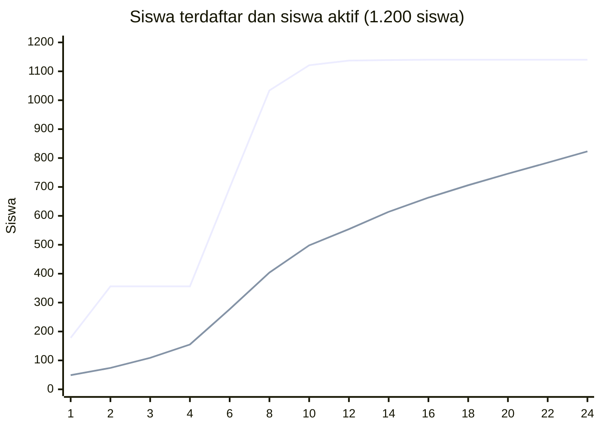

# Simulasi Adopsi dan Kebutuhan Sumber Daya

Perkiraan untuk sekolah berskala SMK Telkom: berapa siswa yang akan aktif, berapa karya dan proyek yang terkumpul, seberapa besar penyimpanan dan server yang dibutuhkan, serta beban kerja guru. Angka ini dipakai di [PROPOSAL.md](PROPOSAL.md).

> **Ini simulasi, bukan data sekolah.** Angka resmi jumlah siswa dan guru SMK Telkom tidak tersedia untuk umum, sehingga simulasi memakai tiga ukuran sekolah (800, 1.200, dan 1.800 siswa). Perilaku pengguna adalah asumsi perencanaan. Ganti dengan data sekolah lalu jalankan ulang skripnya.

## 1. Dasar simulasi

- **Skala acuan:** 1.200 siswa, 36 rombel, 90 guru (kecil: 800 siswa; besar: 1.800 siswa).
- **Alur peluncuran:** percontohan 3 bulan pada sepertiga sekolah, lalu seluruh sekolah dibuka mulai bulan ke-4.
- **Periode:** 24 bulan; bulan libur dan ujian dihitung lebih sepi.
- **Hasil:** nilai tengah dari ribuan kali simulasi, dengan rentang di dalam kurung.
- **Skrip:** [`scripts/simulate-adoption.py`](../scripts/simulate-adoption.py) (`python3 scripts/simulate-adoption.py`).

## 2. Hasil untuk 1.200 siswa

| Bulan | Terdaftar | Siswa aktif | Karya terverifikasi | Penyimpanan berkas | Database |
| --- | ---: | ---: | ---: | ---: | ---: |
| 3 (akhir percontohan) | 356 | 109 | 31 | 0,2 GB | 67 MB |
| 6 | 697 | 277 | 93 | 0,7 GB | 124 MB |
| **12 (akhir tahun 1)** | **1.137** | **554** (463–647) | **419** | **3,4 GB** (1,9–5,7) | **435 MB** |
| **24 (akhir tahun 2)** | **1.140** | **823** (698–936) | **1.442** | **11,6 GB** (6,9–18,9) | **1,1 GB** |

"Siswa aktif" adalah siswa yang punya minimal satu karya terverifikasi: 46% dari seluruh siswa di akhir tahun 1 dan 69% di akhir tahun 2.

Garis atas adalah siswa terdaftar, garis bawah siswa aktif. Pendaftaran sempat datar pada bulan 3–4 karena percontohan baru berjalan di sepertiga sekolah.

## 3. Untuk ukuran sekolah lain

| Ukuran | Siswa aktif akhir tahun 1 | Siswa aktif akhir tahun 2 | Karya (24 bulan) | Penyimpanan (24 bulan) | Database (24 bulan) |
| --- | ---: | ---: | ---: | ---: | ---: |
| Kecil (800) | 371 | 548 | 961 | 7,9 GB | 740 MB |
| **Sedang (1.200)** | **554** | **823** | **1.442** | **11,6 GB** | **1,1 GB** |
| Besar (1.800) | 836 | 1.232 | 2.177 | 17,8 GB | 1,6 GB |

## 4. Beban guru dan proyek tim

- **Beban verifikasi:** ±3 karya per guru pembimbing per bulan (paling ramai ±4). Ini ringan, tetapi cenderung menumpuk di akhir semester; tenggat bertahap dan ringkasan mingguan membantu.
- **Proyek tim:** sekitar 23 proyek sampai akhir tahun 1 dan ±83 sampai akhir tahun 2, dengan asumsi 20% siswa aktif bergabung dalam tim ±4 orang. Angka tepatnya bergantung pada kebijakan proyek di sekolah.

## 5. Hal yang paling memengaruhi hasil

1. **Adopsi.** Jika siswa aktif di tahun kedua hanya 50% (bukan 70%), hasilnya ±600 siswa aktif; jika 85%, ±1.020. Kebijakan sekolah dan pelatihan lebih menentukan daripada kapasitas server.
2. **Video.** Penggerak terbesar penyimpanan: bila video hanya 3% karya, penyimpanan tahun kedua ±7 GB; bila 20%, ±17 GB. Tetapkan batas ukuran video sejak awal.
3. **Chat.** Penggerak terbesar database: bila hanya 15% siswa aktif chat, database tahun kedua ±0,56 GB; bila 50%, ±1,79 GB. Arsipkan pesan lama secara berkala.

## 6. Kebutuhan server

| Komponen | Skenario 1.200 siswa |
| --- | --- |
| Penyimpanan berkas | ±4 GB di akhir tahun 1, ±12 GB di akhir tahun 2 (siapkan 25–30 GB untuk dua tahun) |
| Database | di bawah 0,5 GB di tahun 1, ±1,1 GB di tahun 2 |
| Beban puncak | ±120 pengguna online sekaligus, ±12 permintaan per detik |
| Server | satu server kecil (2 vCPU / 4 GB) atau layanan serverless sudah cukup |

### Perkiraan biaya bulanan

Kurs ±Rp 16.000 per USD; harga layanan perlu diperiksa terkini.

| Komponen | Cloud terkelola | Server sendiri (VPS) |
| --- | --- | --- |
| Hosting aplikasi | ±US$ 20 | ±Rp 200–450 ribu |
| Database | ±US$ 25 | termasuk di VPS |
| Penyimpanan berkas | ±Rp 5–30 ribu | ±Rp 5–30 ribu |
| Backup | termasuk | ±Rp 50–100 ribu |
| Keamanan dan pemantauan | ±Rp 0–300 ribu | ±Rp 0–300 ribu |
| **Total per bulan** | **±Rp 0,7–1,5 juta** | **±Rp 0,3–0,9 juta** |

Untuk sekolah 1.800 siswa kebutuhan penyimpanan dan beban naik sekitar 1,5 kali, sedangkan biayanya relatif sama karena sebagian besar adalah biaya tetap.

## 7. Kesimpulan

1. Sekolah ±1.200 siswa diperkirakan mencapai **±550 siswa aktif dan ±420 karya terverifikasi di akhir tahun pertama**, serta **±820 siswa aktif dan ±1.440 karya di akhir tahun kedua**.
2. Kebutuhan sumber daya **kecil**: puluhan GB penyimpanan, database di bawah 2 GB, dan satu server kecil.
3. Beban guru **ringan** (±3 karya per guru per bulan).
4. Risiko terbesar adalah **adopsi**, bukan teknologi.
5. Dua hal yang perlu diatur sejak awal: **batas ukuran video** dan **pengarsipan pesan chat**.

## 8. Keterbatasan dan pembaruan

- Perilaku pengguna adalah asumsi; belum ada data adopsi dari sekolah serupa.
- Ukuran berkas memakai perkiraan, bukan pengukuran karya nyata siswa (data contoh di database sengaja tidak dipakai karena gambarnya sintetis).
- Lonjakan musiman seperti pameran akhir tahun hanya dihitung sederhana.
- Setelah percontohan, ganti asumsi dengan data terukur (karya per siswa aktif, ukuran berkas rata-rata, aktivitas chat) dan jalankan ulang skrip.
